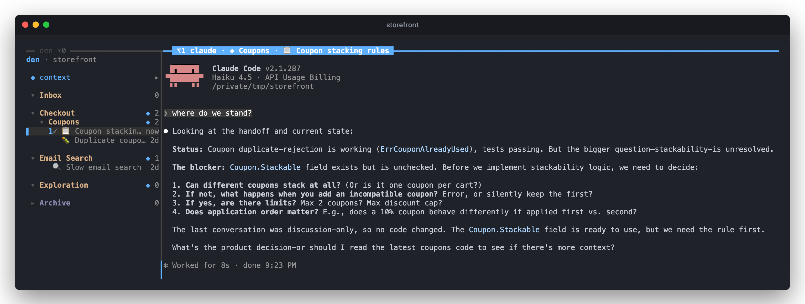

<h1 align="center">den</h1>

<p align="center"><b>An agent for your agent sessions.</b></p>

<p align="center">
den runs your Claude Code and Codex agents side by side in your terminal, keeps track of where every session stands,<br>
and starts each new session with the context it needs. You ask it where you left off. It tells you, and picks the work back up.
</p>

<p align="center"></p>

On Friday you had two agents going: one fixed a coupon bug and left an open question for product, the other tracked down a slow search. Now you're back, and you don't remember the details.

You press `c` and ask den: *where did I leave off on Friday?* den keeps notes on every session in the repo, so it answers with a few lines per session. Then you ask it to *open a new session that picks up the coupon work*. den writes a handoff (where it stands, what was decided, what's next, which files matter) and shows it to you as a plan. You press ↵, and a new agent opens with that handoff added to its system prompt. You ask it *where do we stand?*:

<p align="center"></p>

It answers without opening a single file. Everything it knows came from den's handoff and the folder's notes.

**What den is:** a terminal app. It's a narrow panel next to your agents, and it calls a model through the `codex` or `claude` CLI to read your sessions so you don't have to. Your agents are the ordinary Claude Code and Codex you already use.

---

**Contents:** [Install](#install) · [The idea](#the-idea) · [A tour](#a-tour) · [Ask den](#ask-den) · [What den suggests](#what-den-suggests) · [A day with den](#a-day-with-den) · [Keys](#keys) · [Trust, cost and data](#trust-cost-and-data) · [Good to know](#good-to-know) · [Troubleshooting](#troubleshooting)

## Install

```sh
brew tap IgorAmi52/den https://github.com/IgorAmi52/den
brew install den
```

Then start it inside any git repo:

```sh
cd ~/code/your-repo
den
```

| You need | Why |
| --- | --- |
| macOS | den is built and tested on macOS. |
| [Claude Code](https://docs.anthropic.com/en/docs/claude-code) or [Codex](https://github.com/openai/codex), or both | These are the agents den runs for you. |
| `codex` logged in (or `claude`) | den's own brain: it names sessions, writes their progress and answers you in the chat. It uses codex when it's installed, otherwise claude. Without either, den still runs your agents, but it can't name or summarize them. |
| tmux | Installed by brew with den. You don't need to know tmux; den sets it up. |

On its first run in a repo, den checks two things:

1. **Your Option key.** den's ⌥ shortcuts need your terminal to send Option as a key instead of typing characters like `¬`. den asks you to press ⌥L to check. In Terminal.app or Ghostty, ↵ turns the setting on for you. In iTerm2, set *Settings → Profiles → Keys → Left Option key* to *Esc+*.
2. **Your past sessions.** den reads the 10 newest Claude and Codex sessions you've had in this repo, says which look unfinished or worth keeping, and you tick the ones to bring in. Nothing else is imported.

> [!TIP]
> den runs in its own tmux session, so closing the terminal window doesn't stop your agents. Run `den` in the repo again to come back to them. If you're already inside tmux, den opens in a new window instead.

## The idea

You probably start several agent sessions a day. Each one learns something: a decision, a gotcha, the reason a test is flaky. Then the session ends and that knowledge is gone. The next session starts from zero, and you paste the same "read this first" notes into it again. A week later you have forty sessions called "fix the thing" and no idea which one decided what.

den is built around four ideas.

**1. Sessions are disposable.** Use one session per task, and let it go when the task is done. Long sessions get worse as they fill up, and Claude Code deletes old transcripts after 30 days anyway. den archives a session 3 days after you last used it. It stays resumable from the Archive for 25 more days, and you never have to clean anything up.

**2. Context is what lasts.** What matters after a session ends is what it found and decided. In den, that lives in a **folder's context**: a short markdown file that every new session in the folder starts with. Context is personal. It lives in `~/.den`, outside your repo, so you can keep notes about a shared codebase without touching the `CLAUDE.md` other people maintain.

**3. A folder is something you launch into.** Folders are den's own labels, not directories on disk: every agent runs in your repo, wherever you started den. They aren't for filing old sessions away either. You pick a folder when you *start* a session, and the session begins with that folder's context. There are two kinds:

| A folder for… | Example | Its context says |
| --- | --- | --- |
| **a piece of work** | `Checkout → Coupons` | what was decided, what's still open, which files matter |
| **a way of working** (a skill folder) | `Exploration` | how to work: *research only, never edit files, cite file and line* |

Folders nest, and context adds up from the top: a session in `Coupons` starts with the repo's notes, then `Checkout`'s, then `Coupons`'. A skill folder is den's own idea, not a Claude Code skill. (If you keep running one of your own Claude or Codex skills, den offers a skill folder that uses it as context.)

**4. den notices, you decide.** den watches your sessions and, rarely, suggests something: *this plan is worth a folder*, *this finding belongs in Coupons' notes*. Each suggestion waits until you say yes; nothing happens on its own.

You almost never write context yourself. You ask den: *make the context from the latest session*, *add that we decided X*, *keep only the decisions*. Or you accept one of its suggestions.

## A tour

### Your agents, side by side

<p align="center"></p>

den is the narrow column on the left. Your agents sit to its right, up to four at a time, each in its own pane. On every row and every pane border you can see:

- **which agent it is**: `⌥1`, `⌥2`, … also jump to it from any pane.
- **what it's doing**: `●` working, `!` needs you (here agent 1 is waiting for permission, so its border turns amber), `✓` done and it's your turn.
- **which folder it started in**: `◆ Coupons` means it began with Coupons' context.
- **what it's about**: den names each session from what it's doing, with an emoji for its kind (🐛 fix, ✨ build, 🔍 investigate, 📋 plan, 📝 docs, 🧹 clean up, 💬 quick question). A title you set yourself with `r` stays.

**Inbox** holds sessions that aren't in a folder, including ones you start outside den, from your IDE or another terminal. **Archive** holds sessions you haven't touched for 3 days; ↵ still resumes them.

### Where every session stands

<p align="center"></p>

Press `z` for the wide view. For the selected session, den shows its **goal, what's done and what's next**. den keeps these up to date with a cheap review every few prompts. You also see the folder chain it started with (`storefront → Checkout → Coupons`), your last prompt, the agent's last reply and the files it edited. ↵ on a closed session resumes it.

### Folders and their context

<p align="center"></p>

Press → on a folder to open its context. Then:

- **↓ asks den to change it.** Here, product made a decision and the code is built, so the note "product still needs to decide" is stale. You say so in one line. den shows the change as a diff, and ↵ saves it. Every new session in Coupons starts with the new version.
- **↑ edits it by hand.** You can also open it in `$EDITOR`.
- **A file of your own works too.** Tell den *link docs/PLAN.md to Coupons*, and that file becomes the folder's context instead of den's. den only changes your file after a yes.

The repo has a context of its own as well, the `◆ context` row at the top, which every session in the repo starts with.

## Ask den

Press `c` in den to talk to it about the whole repo. den reads where every session stands and, when it needs more, their full conversations. It answers, or it proposes a plan that waits for your ↵.

**Recall.** Find your way back without scrolling through transcripts.
- *where did I leave off on Friday?*
- *what did we decide about pagination?*
- *which session touched the payment client?*

**Resume.** Continue earlier work in a fresh session that starts with a handoff.
- *open a new session that picks up the coupon work*
- *start a session in Eval where the flaky-test one stopped*

**Organize.** Shape folders and their context in plain words.
- *make an Exploration skill folder: research only, no code changes*
- *make the context of Checkout from the latest session*
- *move the search session into Email Search*
- *link docs/PLAN.md as Eval's context*

Nothing changes until you confirm the plan. If you type something else instead, den drops the plan and answers your new message.

## What den suggests

<p align="center"></p>

Once a session has a few prompts and has gone quiet for 10 minutes, den reads all of it and asks one question: *did this produce something worth keeping after the session ends?* Usually the answer is no, and den says nothing. When the answer is yes, a card waits at the bottom of den's column, and `⇥` opens it. This is the card that made the Email Search folder in the screenshots above:

| Card | What yes does |
| --- | --- |
| **NOTES** | Adds a finding or decision to a folder's context: *"Coupon.Stackable is unchecked; product still needs to decide…"* |
| **FOLDER** | Makes a folder for work that will go on, with its context drafted from the session, and moves the session in. |
| **SKILL** | Makes a folder for a way of working you set up and will want again. |
| **LINK** | Uses a markdown file an agent wrote, like a plan, as a folder's context. |
| **RULE** | Adds a rule you clearly stated, like *never add comments*, to your global `~/.claude/CLAUDE.md` and `~/.codex/AGENTS.md`, never the repo's. You can also tell den to keep it in one folder or in the repo's context instead. |

Each card shows exactly what yes would write, quotes the parts of the session it's based on, and says why. **↵** yes, **⌫** no (that card never comes back), or **type** to tell den what to do instead: *call it Search performance*, *put it in Checkout*. When you say no, den writes down a short lesson when there is one, so it suggests better next time. The lessons are in `~/.den/lessons.md`, and you can edit them.

den only suggests when it's confident, keeps at most 5 cards waiting, and shows one per session.

## A day with den

1. **Come back by asking.** Run `den` in the repo, press `c`: *where did I leave off yesterday?* Then *pick up the pagination work*.
2. **Start new work in the folder it belongs to.** Select `Eval`, press `n`, pick Claude or Codex, and the agent starts with Eval's context. One task, one session.
3. **Keep what matters.** Answer cards with ↵ or ⌫. When you learn something yourself, open the folder's context and tell den.
4. **Let sessions go.** They archive themselves after 3 days; the folders keep what they found.

## Keys

Press `?` in den for all of them.

| From any pane | |
| --- | --- |
| `⌥1`–`⌥4` | jump to that agent |
| `⌥0` | jump to den, and back |
| `⌥⇥` | next pane |
| `⌥N` | start a new agent |
| click | focus any pane |

| In den | |
| --- | --- |
| `↵` | resume a session, focus an agent, open a folder |
| `n` / `N` | new session in the selected folder, with / without its context |
| `c` | ask den |
| `⇥` | answer den's suggestions: `↵` yes, `⌫` no, or type |
| `→` | open a folder's context (`↓` ask den to change it, `↑` edit by hand) |
| `z` | wide view with a preview |
| `f` / `F` | new folder / subfolder |
| `m` `r` `a` `d` | move, rename, archive, delete |
| `/` | filter |
| `esc` | back out without changing anything |
| `q` | quit (closes the agents in it) |

## Trust, cost and data

**What den never does.**
- It never edits your code. Besides its own files in `~/.den`, the only files it writes are a context file you linked, your `~/.claude/CLAUDE.md` and `~/.codex/AGENTS.md` for a RULE card, and your terminal's Option-key setting on the first run, each only after you press ↵.
- It never runs commands in your repo, git included. Its own model calls are one-shot text calls with no tools; your agents do the work, in panes you can see.
- It never moves or files your sessions on its own.
- It never deletes agent history. Archiving and forgetting only affect den's own list.
- It never changes your Claude or Codex settings. Each agent den starts gets its context and a status hook on its command line; sessions started elsewhere are read from their transcripts.

**What it costs.** den's own model calls are one-shot calls with no tools, through the `codex` CLI you already use (or `claude`). A progress review costs about 0.2¢, and a card review, a chat answer or a context change about 4¢. Everything den did for the demo in these screenshots (six sessions named and tracked, two cards, two chat answers, one context change and a first run) came to under 30¢. Your agents cost what they always cost.

**Where your data lives.** Everything is plain files on your Mac, outside your repo:

```
~/.den/repos/<repo>/den.json                    folders, sessions, waiting suggestions
~/.den/repos/<repo>/folders/<id>/context.md     a folder's context
~/.den/repos/<repo>/folders/repo/context.md     the repo's context
~/.den/repos/<repo>/decisions.jsonl, calls.jsonl  every suggestion, answer and model call, for evaluation
~/.den/lessons.md                               what den learned from your noes
```

**Helping improve den.** `den eval export` packs den's logs, state and the transcripts of the sessions it tracks into one archive, to send to the maintainer. It contains your prompts, your agents' conversations and parts of your code, so only share it if that's fine.

## Good to know

- **Status:** early, and macOS only.
- **Agents share one checkout.** Every agent runs in the folder where you started den, so two agents editing the same files will collide, just as in two terminals. Run den from a git worktree to give its agents their own checkout; all worktrees of a repo share one den tree.
- **Up to 4 agents at a time** in one den window.
- **den's model sees your sessions.** To name and summarize them, den sends excerpts of your prompts and the agents' replies to the model behind `codex` (OpenAI, with your codex login) or `claude` (Anthropic). It sends nothing anywhere else.
- **Your tmux setup is safe.** den runs in a tmux session of its own, and its ⌥ keys only act inside den's window; elsewhere they reach your programs as usual.
- **Context costs tokens.** The context pane shows each folder's size in tokens, so you can see what every new session starts with.
- **Old transcripts.** Claude Code deletes transcripts after 30 days. den drops a session from its list 25 days after archiving it, before that happens. What the session found stays in its folder's context.

## Troubleshooting

**The ⌥ keys type characters instead of working.** Your terminal sends Option as text. In Terminal.app turn on *Settings → Profiles → Keyboard → Use Option as Meta key*. In Ghostty add `macos-option-as-alt = true` to its config and reload it with ⌘⇧,. In iTerm2 set *Settings → Profiles → Keys → Left Option key* to *Esc+*. Terminal.app and iTerm2 apply it to new windows.

**den doesn't name or summarize my sessions.** den needs `codex` (logged in) or `claude` on your `PATH` for its own calls. After 3 failed calls in a row it switches its model off until the next start.

**I closed the terminal. Are my agents gone?** No. Run `den` in the same repo again.

**Uninstall.** `brew uninstall den`, then remove `~/.den` if you want den's data gone too. Your agents' own history stays untouched.

<sub>The screenshots come from a small demo repo, with its agents running on Claude Haiku.</sub>
