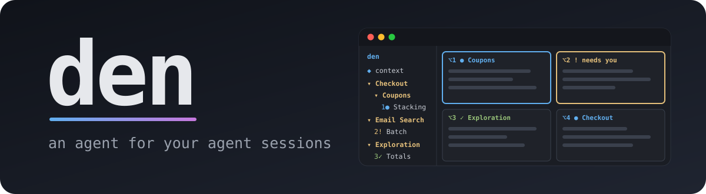
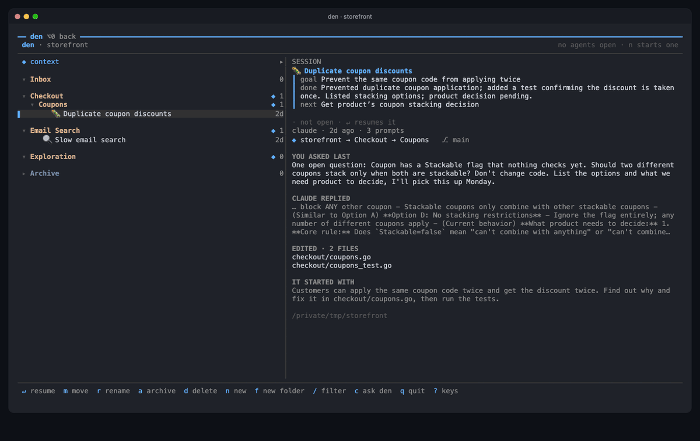
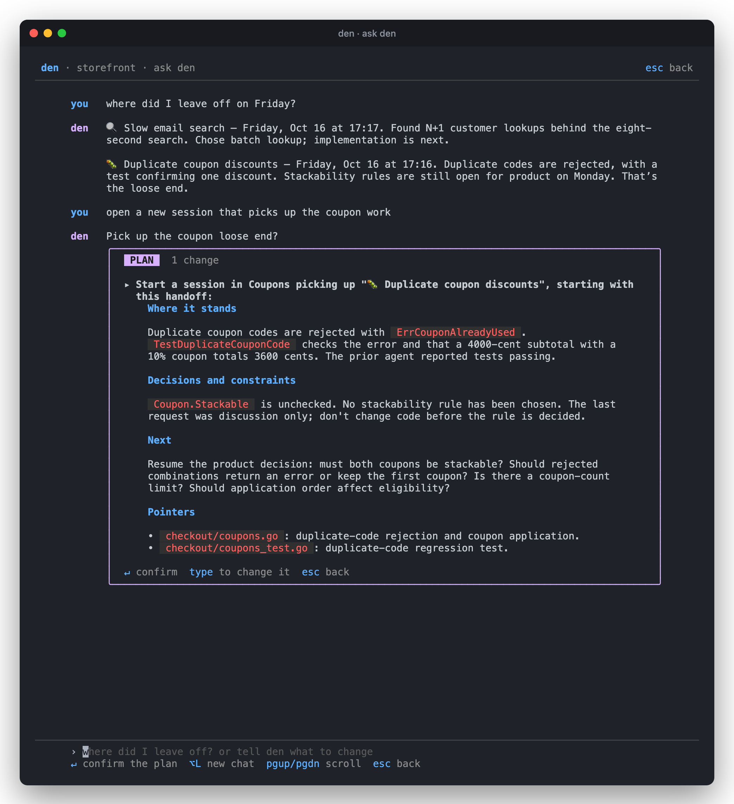
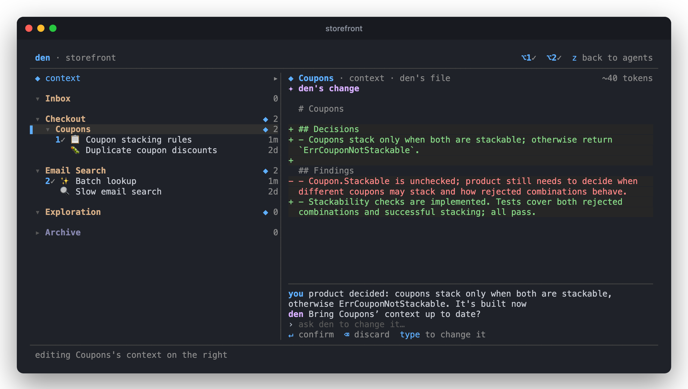
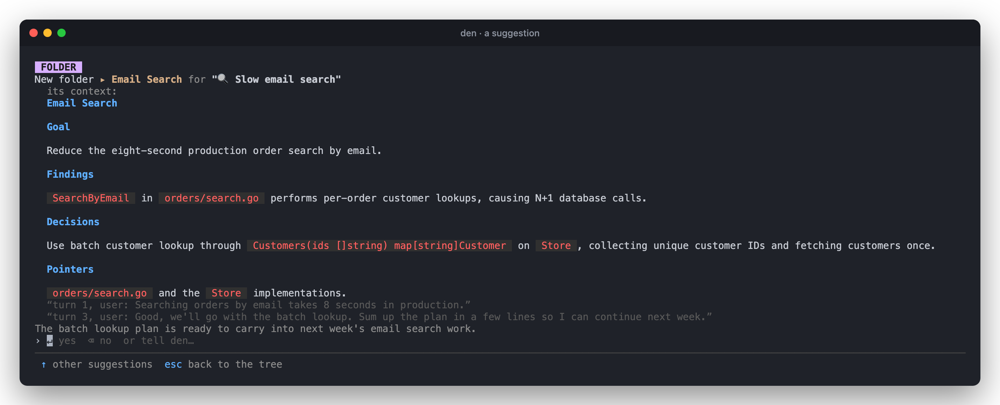
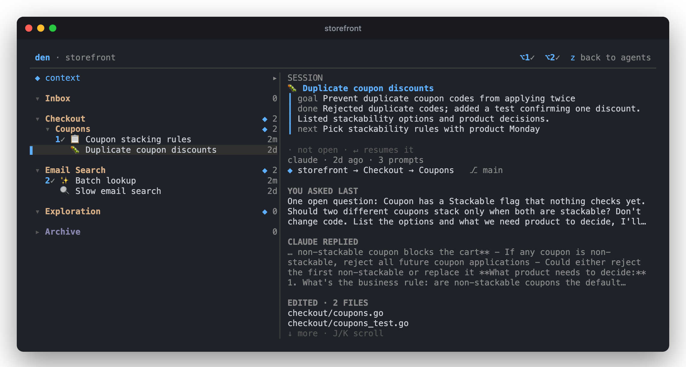
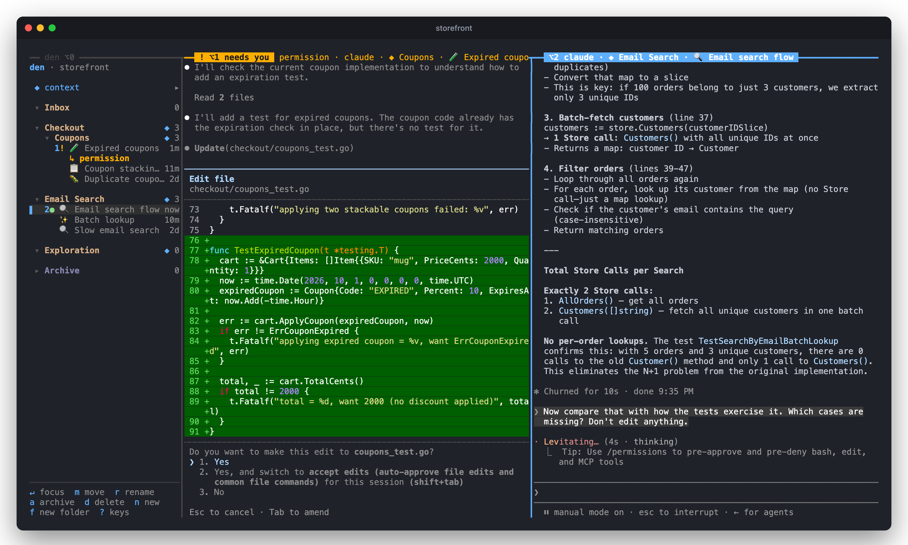

<div align="center">



### 🛖 Run *Claude Code* & *Codex* side by side, ask where you left off, start every session with the right context 🛖

[](#-quickstart)
[](#-quickstart)
[](#-quickstart)
[](#-features)

</div>

---

<p align="center"></p>

<p align="center"><sub>Ask about Friday → den writes a handoff → a new agent already knows where things stand → open three more in other folders → <kbd>⌥</kbd><kbd>⇥</kbd> between them. Keys pressed are shown under the window. <a href="docs/den-demo.mp4">MP4</a></sub></p>

## ✨ Highlights

<table>
<tr>
<td width="33%" valign="top">

🧠 **Remembers every session**<br>
<sub>goal · done · next, kept up to date while you work</sub>

</td>
<td width="33%" valign="top">

🔁 **Picks up where you left off**<br>
<sub>ask *"where did I leave off?"*, get a new agent with a handoff</sub>

</td>
<td width="33%" valign="top">

🪟 **Four agents, one window**<br>
<sub><kbd>⌥</kbd><kbd>⇥</kbd> to cycle · <kbd>⌥</kbd><kbd>1–4</kbd> to jump · `!` when one needs you</sub>

</td>
</tr>
<tr>
<td width="33%" valign="top">

📁 **Context per folder**<br>
<sub>every session starts with its folder's notes · yours, never committed</sub>

</td>
<td width="33%" valign="top">

✦ **Keeps what matters**<br>
<sub>suggests notes and folders from finished sessions · <kbd>↵</kbd> or <kbd>⌫</kbd></sub>

</td>
<td width="33%" valign="top">

🔒 **Never touches your code**<br>
<sub>no commands, no git · nothing written without a yes</sub>

</td>
</tr>
</table>

## 🚀 Quickstart

```sh
brew tap IgorAmi52/den https://github.com/IgorAmi52/den
brew install den

cd your-repo
den
```

- **Needs:** macOS · [Claude Code](https://docs.anthropic.com/en/docs/claude-code) and/or [Codex](https://github.com/openai/codex) · `codex` (or `claude`) logged in for den's own calls · tmux comes with brew
- **First run:** press <kbd>⌥</kbd><kbd>L</kbd> so den can check your Option key (it fixes Terminal.app and Ghostty for you) · tick which of your 10 newest past sessions to bring in
- **Coming back:** run `den` in the repo again. Closing the terminal doesn't stop your agents.

## ⌨️ Keys

| Anywhere in den's window | |
| --- | --- |
| <kbd>⌥</kbd><kbd>⇥</kbd> | **next pane** · den → agent 1 → … → den |
| <kbd>⌥</kbd><kbd>1</kbd>–<kbd>4</kbd> | jump to an agent |
| <kbd>⌥</kbd><kbd>0</kbd> | jump to den, and back |
| <kbd>⌥</kbd><kbd>N</kbd> | new agent |

| In den | |
| --- | --- |
| <kbd>c</kbd> | **ask den** |
| <kbd>n</kbd> / <kbd>N</kbd> | new session in the selected folder, with / without its context |
| <kbd>↵</kbd> | resume a session · focus an agent |
| <kbd>⇥</kbd> | den's suggestions: <kbd>↵</kbd> yes · <kbd>⌫</kbd> no · or type |
| <kbd>→</kbd> | a folder's context: <kbd>↓</kbd> ask den to change it · <kbd>↑</kbd> edit by hand |
| <kbd>z</kbd> | wide view with a preview |
| <kbd>f</kbd> <kbd>F</kbd> · <kbd>m</kbd> <kbd>r</kbd> <kbd>a</kbd> <kbd>d</kbd> | folder, subfolder · move, rename, archive, delete |
| <kbd>/</kbd> · <kbd>?</kbd> · <kbd>q</kbd> | filter · all keys · quit |

Marks: `●` working · `!` needs you · `✓` your turn · `◆` has context · `✦` den has a suggestion

## 🧭 How to think with den

- **One task, one session.** Let sessions go. They archive themselves 3 days after you last used them, and stay resumable.
- **Context is what lasts.** A folder's context is a short markdown file every session started in it begins with. Folders nest, and context adds up: `repo → Checkout → Coupons`.
- **Two kinds of folders.** A piece of work (`Checkout → Coupons`: what's decided, what's open) or a way of working (`Exploration`: *research only, cite file and line*). Folders are den's own labels, not directories.
- **Don't write context, ask for it.** *"make the context from the latest session"*, *"add that we decided X"*, or accept one of den's suggestions.

## 📖 Features

<details>
<summary><b>💬 Ask den</b> · recall, resume, organize</summary>
<br>



<kbd>c</kbd> opens a chat about the whole repo. den answers from its notes on every session, and reads full conversations when it needs to. Changes come as a plan that waits for <kbd>↵</kbd>.

| | Try |
| --- | --- |
| **Recall** | *where did I leave off on Friday?* · *what did we decide about pagination?* |
| **Resume** | *open a new session that picks up the coupon work* |
| **Organize** | *make an Exploration skill folder: research only* · *move the search session into Email Search* · *link docs/PLAN.md as Eval's context* |

A handoff covers where it stands, decisions, what's next and the files involved. It goes into the new agent's system prompt.

</details>

<details>
<summary><b>📁 Folders & context</b> · what every new session starts with</summary>
<br>



<kbd>→</kbd> on a folder opens its context. <kbd>↓</kbd> asks den to change it, and you get a diff to confirm. <kbd>↑</kbd> edits it by hand (<kbd>⌥</kbd><kbd>O</kbd> opens `$EDITOR`). To use a file of your own instead, like `docs/PLAN.md`, tell den *"link docs/PLAN.md to Coupons"*. The `◆ context` row at the top is the repo's, and every session starts with it.

</details>

<details>
<summary><b>✦ Suggestions</b> · den notices what's worth keeping</summary>
<br>



When a session has gone quiet for 10 minutes, den reads all of it once. Usually it says nothing. When something is worth keeping, a card waits at the bottom of den: <kbd>↵</kbd> yes · <kbd>⌫</kbd> no (it won't come back) · or type what to do instead.

| Card | Yes does |
| --- | --- |
| **NOTES** | adds a finding or decision to a folder's context |
| **FOLDER** | new folder for work that will go on, with drafted context; moves the session in |
| **SKILL** | new folder for a way of working you'll want again |
| **LINK** | uses a markdown file an agent wrote (like a plan) as a folder's context |
| **RULE** | adds a rule you stated to your global `~/.claude/CLAUDE.md` and `~/.codex/AGENTS.md` |

At most 5 cards wait at once, one per session. Each no teaches den a lesson, kept in `~/.den/lessons.md`.

</details>

<details>
<summary><b>🔎 Where every session stands</b> · <kbd>z</kbd> for the wide view</summary>
<br>



Goal, done and next, the folder chain the session started with, your last prompt, the agent's last reply and the files it edited. <kbd>↵</kbd> on a closed session resumes it. Sessions you start outside den (an IDE, another terminal) show up in **Inbox**.

</details>

<details>
<summary><b>🪟 Agents side by side</b> · up to four, with status on every border</summary>
<br>



Each pane's border shows its key, status, folder and title. den names sessions with an emoji for their kind: 🐛 fix · ✨ build · 🔍 investigate · 📋 plan · 📝 docs · 🧹 clean up · 💬 question. A title you set with <kbd>r</kbd> stays.

</details>

<details>
<summary><b>🔒 Trust, privacy & cost</b></summary>
<br>

- **Never edits your code or runs commands in your repo**, git included. Its model calls are one-shot text calls with no tools.
- **Writes only with a yes:** a context file you linked, your global `CLAUDE.md`/`AGENTS.md` (RULE cards), your terminal's Option key (first run). Everything else lives in `~/.den`.
- **Leaves your Claude and Codex settings alone.** Context and a status hook go on each agent's command line.
- **Sends excerpts of your sessions** to the model behind `codex` (OpenAI) or `claude` (Anthropic), to name and summarize them. Nothing else leaves your Mac.
- **Cost:** about 0.2¢ per progress review, about 4¢ per card review, chat answer or context change. The whole demo above came to under 30¢.

</details>

<details>
<summary><b>💡 Good to know</b></summary>
<br>

- **Status:** early · macOS only.
- **Agents share one checkout:** they run where you started den. To give agents their own checkout, run den from a git worktree. All of a repo's worktrees share one tree.
- **Your tmux setup is untouched:** den runs in its own tmux session, and its <kbd>⌥</kbd> keys only act in den's window.
- **Old sessions:** den drops a session from the Archive 25 days after archiving it, before Claude Code deletes transcripts at 30 days. What it found stays in its folder.

</details>

<details>
<summary><b>🗂️ Files</b></summary>
<br>

```
~/.den/repos/<repo>/den.json               folders, sessions, waiting suggestions
~/.den/repos/<repo>/folders/*/context.md   each folder's context (repo/ is the repo's)
~/.den/repos/<repo>/*.jsonl                every suggestion, answer and model call
~/.den/lessons.md                          what den learned from your noes
```

`den eval export` packs these with the transcripts of tracked sessions, to send to the maintainer. It includes your prompts and code.

</details>

<details>
<summary><b>🛠️ Troubleshooting</b></summary>
<br>

- **⌥ keys type characters** like `¬`. **Terminal.app:** Settings → Profiles → Keyboard → *Use Option as Meta key*. **iTerm2:** Settings → Profiles → Keys → *Left Option key: Esc+*. **Ghostty:** `macos-option-as-alt = true`, then reload with <kbd>⌘</kbd><kbd>⇧</kbd><kbd>,</kbd>.
- **Sessions don't get named:** den needs `codex` (logged in) or `claude` on your `PATH`. After 3 failed calls in a row it pauses its model until the next start.
- **Uninstall:** `brew uninstall den`, then delete `~/.den`. Your agents' history is untouched.

</details>

<br>
<p align="center"><sub>The screenshots and demo come from a small demo repo, with agents on Claude Haiku. 🛖</sub></p>
